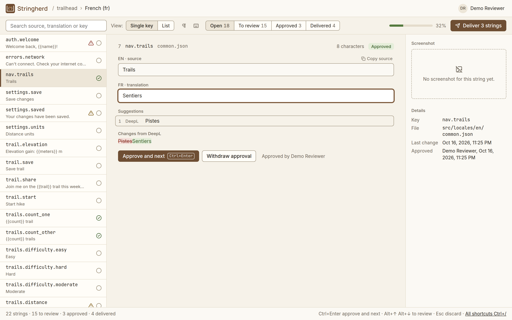
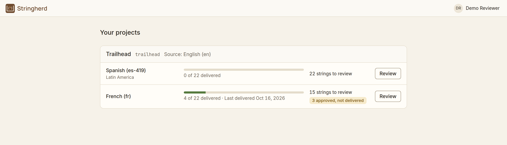
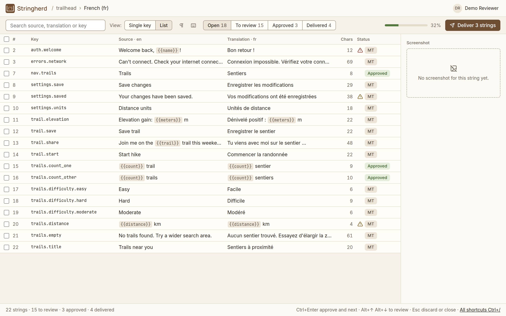
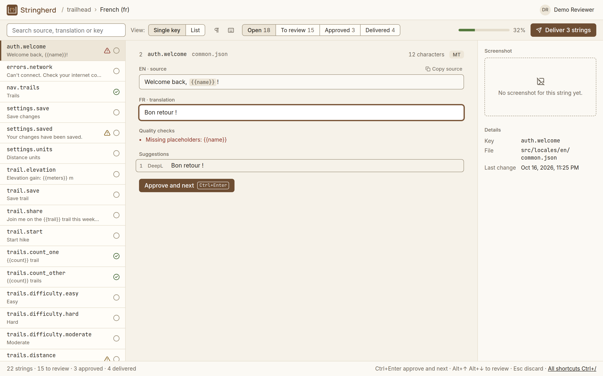
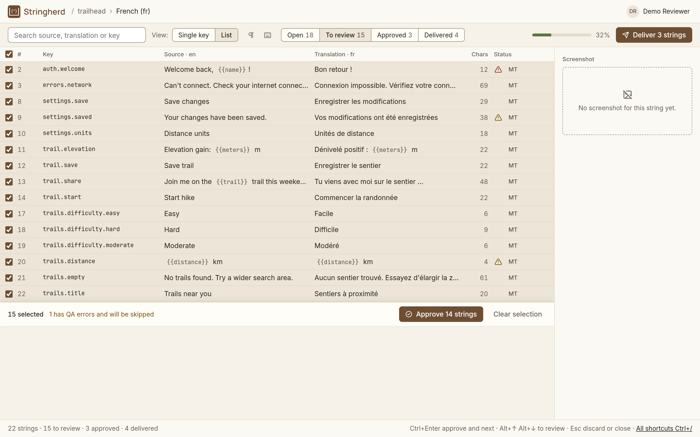
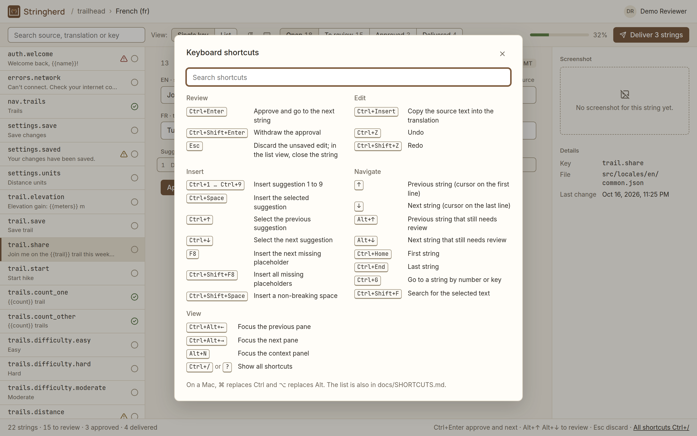
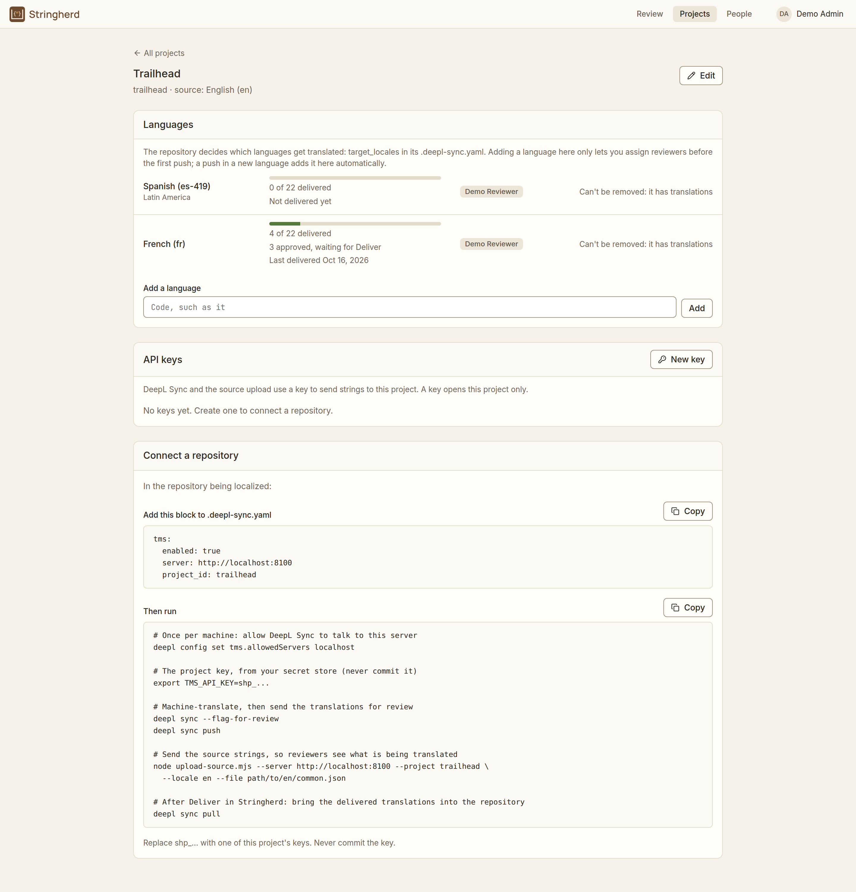
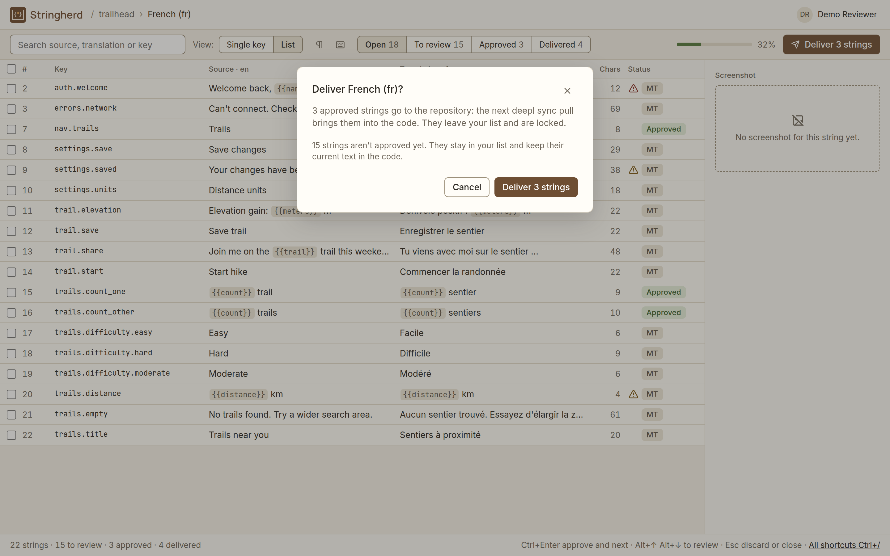

# Stringherd

**Open-source review server for [DeepL Sync](https://github.com/DeepL/deepl-cli/blob/main/docs/SYNC.md).**

DeepL's CLI machine-translates the locale files in your repository. Stringherd is where linguists review those translations, with the context they need, before the reviewed versions go back into your code.

> **Status: v1.0.0, released 17 October 2026, in use.** The full loop works, from DeepL Sync through review in Stringherd back into the code, and it shipped French to a live app ([FitJournal](https://fit-journal.com)) in October 2026. Reviewer accounts, admin screens, quality checks, bulk actions, Deliver and Phrase-style keyboard shortcuts are in place, and `docker compose up` runs a demo locally. Next: keeping existing translations when a language joins (v1.1), then a hosted demo ([roadmap](ROADMAP.md), [changelog](CHANGELOG.md)).



---

## Try it with Docker

With [Docker Desktop](https://www.docker.com/products/docker-desktop/) running, from the repository root:

```bash
docker compose up --build
```

Then open **http://localhost:8200** and sign in as `reviewer@trailhead.example` (or `admin@trailhead.example`), password `trailhead-demo`. A demo project, Trailhead, is waiting: a small fictional hiking app with French partly reviewed and delivered, and Spanish just arrived from DeepL. Nothing else to install, and no DeepL key needed.

- `Ctrl+C` stops it; `docker compose up` starts it again with your changes kept.
- `docker compose down -v` deletes the demo data, for a fresh start next time.

Runs on your computer only (`127.0.0.1`); the demo password is public, so do not expose it. Details, and how it is built: [docs/DEVELOPMENT.md](docs/DEVELOPMENT.md#running-stringherd-with-docker).

### What to look at

<table>
<tr>
<td width="50%"><a href="docs/images/01-projects.png"></a><br><sub>Your projects and languages, with review progress.</sub></td>
<td width="50%"><a href="docs/images/02-list.png"></a><br><sub>Open French and switch to <b>List</b>: status, quality warnings and character counts for every string.</sub></td>
</tr>
<tr>
<td width="50%"><a href="docs/images/04-qa-error.png"></a><br><sub>Open <code>auth.welcome</code>: DeepL dropped <code>{{name}}</code>, so the quality check blocks approval until it is fixed.</sub></td>
<td width="50%"><a href="docs/images/05-bulk.png"></a><br><sub>Select all and approve: strings with errors are skipped and listed.</sub></td>
</tr>
<tr>
<td width="50%"><a href="docs/images/07-shortcuts.png"></a><br><sub>Press <code>Ctrl+/</code> for the Phrase-style keyboard shortcuts.</sub></td>
<td width="50%"></td>
</tr>
</table>

## How it works

```
Your repo: English source strings change
   │
   ▼
deepl sync                 machine-translates new or changed strings (DeepL API)
   │
   ▼
deepl sync push  ───────►  Stringherd       stores each translation as "machine translated"
                              │
                              ▼
                           Linguists review, edit and approve,
                           then Deliver the language
                              │
deepl sync pull  ◄───────  only delivered translations are exported
   │
   ▼
Your repo: reviewed translations land in the locale files
```

DeepL Sync defines a small REST contract for a translation management system (TMS) and delegates human review to it, but does not ship one. Stringherd implements that contract and focuses on what reviewers actually need: visual context, regional variants and terminology.

## Features

| Status | Feature |
|---|---|
| ✅ Done | DeepL Sync TMS contract: push, export and project status endpoints |
| ✅ Done | API-key authentication (`ApiKey` and `Bearer`, as sent by DeepL Sync), with keys per project, stored hashed and revocable |
| ✅ Done | Idempotent, concurrency-safe push: re-pushing unchanged strings keeps their approval; only a genuinely new machine translation goes back to review, so a reviewer's edit is never overwritten by a re-push |
| ✅ Done | Deliver: approved strings become pullable only when the reviewer delivers the language; delivered strings are locked, and an admin can reopen one to fix it |
| ✅ Done | Source upload: one request per catalog, change detection, approvals reset when the source changes |
| ✅ Done | Reviewer accounts: admins and reviewers, sign-in with a secure session cookie, temporary passwords changed at first sign-in, reviewers assigned per project and language |
| ✅ Done | Admin screens: projects and their languages, API keys shown once, setup steps per project, people with temporary passwords and language assignments |
| ✅ Done | Review API: list strings with source and machine translation, edit, approve, bulk approve; records who approved each string |
| ✅ Done | Quality checks: empty and placeholder errors block approval in the review screen and on the server; warnings for same as source, spacing, numbers, ending punctuation, double spaces, unbalanced brackets and quotes |
| ✅ Done | Try it with one command: Docker Compose with its own database and a demo project |
| ✅ Done | Review interface: sign-in, project overview, review screen with single key and list views, DeepL suggestion with diff, approve and next, status symbols, QA checks, bulk approve and withdraw, Deliver, Phrase-style keyboard shortcuts with an in-app reference ([docs/SHORTCUTS.md](docs/SHORTCUTS.md)), non-printable characters |
| 📋 Planned | Screenshots showing where each string appears in the app, captured automatically |
| 📋 Planned | Configurable workflows per locale (MT only, MT + review, MT + review + sign-off) |
| 📋 Planned | Existing translations imported per language, and regional variants stored as overrides (e.g. `es-AR` holds only what differs from `es-419`); design in [docs/LOCALES-PLAN.md](docs/LOCALES-PLAN.md) |
| 📋 Planned | Translation memory with visual context, glossary checks |
| 📋 Planned | GitHub App: connect a repository from the UI; Stringherd opens the setup PR |

See the **[roadmap](ROADMAP.md)** for what's next and in which order.

## Using it with a project

The full loop, as it ran for [FitJournal](https://fit-journal.com)'s French in October 2026: 240 strings from DeepL, reviewed in Stringherd, delivered and live. The commands run in the project being localized. `deepl` is the DeepL CLI; it reads the DeepL key from `DEEPL_API_KEY` and the project's Stringherd key from `TMS_API_KEY` (FitJournal passes both with `op run`; any way of setting environment variables works).

### 1. Set up the project in Stringherd

An admin creates the project under **Projects**, adds its languages, creates an API key and assigns reviewers. The project's page shows the setup with its own values filled in.

In the project being localized, `.deepl-sync.yaml` points DeepL Sync at Stringherd, with the same project id:

```yaml
tms:
  enabled: true
  server: http://localhost:8100
  project_id: fitjournal
```

Once per computer, approve the destination:

```bash
deepl config set tms.allowedServers localhost
```

<a href="docs/images/08-setup.png"></a>

### 2. Machine-translate

```bash
deepl sync
```

DeepL translates the new and changed strings and writes them into the locale files; the lockfile (`.deepl-sync.lock`) records what was translated. A language that already has translations in the repository needs care: the first sync overwrites them (see [the notes below](#notes-on-the-deepl-sync-contract)).

### 3. Send them for review

```bash
deepl sync push
node path/to/stringherd/scripts/upload-source.mjs \
  --project fitjournal --file web-react/src/i18n/locales/en/common.json
```

```
Pushed 240 translations to TMS at http://localhost:8100
```

The push sends each translation, but not the English it came from, so the upload script sends the source strings. On later runs it reports only what changed (`unchanged: 240` when nothing did), and sends back to review any approved string whose English changed.

### 4. Review and Deliver

Reviewers work through the strings in the review screen, then click **Deliver** for the language. Approved strings wait until then, so a review in progress never reaches the code.

<a href="docs/images/06-deliver.png"></a>

### 5. Bring them back

```bash
deepl sync pull
git diff
```

The pull writes the delivered translations into the locale files and records them in the lockfile. From there it is an ordinary change: review the diff, commit, merge and deploy.

### On Windows

- **The `deepl` command:** `npm install` in Stringherd's repository installs the DeepL CLI it is tested with (vendored in `vendor/`). To use it from another project in Git Bash, add it to the PATH: `export PATH="/c/path/to/stringherd/node_modules/.bin:$PATH"`.
- **Permission warnings:** the CLI warns on every run that its config files are readable by other users. It is a Unix permission check that does not apply to Windows; the warnings are harmless.
- **Target paths:** path resolution fails for source paths like `locales\en\common.json`. Setting `target_path_pattern` on the bucket works around it, for example `target_path_pattern: "web-react/src/i18n/locales/{locale}/{basename}"`.

## Notes on the DeepL Sync contract

Building against the contract surfaced a few behaviors worth knowing (the full list is in the [roadmap](ROADMAP.md#known-limitations)):

- **Push does not send the source text**, only key, locale and translation. A review interface needs the source, so Stringherd needs another way to obtain it.
- **Keys have no file dimension.** Two locale files that share key names cannot be told apart by the TMS.
- **The first sync overwrites existing translations.** Without a lockfile, every key counts as missing. Existing translations can be adopted safely by pushing them, approving them and pulling them back, which records them in the lockfile.
- **A pull records no review status in the lockfile.** The export carries only text, so DeepL Sync cannot tell a reviewed string from a machine translation, and writes the pulled strings without `review_status`.
- **On Windows**, target path resolution needs a workaround ([above](#on-windows)).

## Documentation

| Document | What's in it |
|---|---|
| [docs/API.md](docs/API.md) | Every endpoint: the DeepL Sync contract, the source upload, the review and admin API |
| [docs/DEVELOPMENT.md](docs/DEVELOPMENT.md) | Setup, running the server and the UI, Docker, tests, migrations, commands, troubleshooting |
| [docs/SHORTCUTS.md](docs/SHORTCUTS.md) | Keyboard shortcuts of the review screen |
| [docs/UI-PLAN.md](docs/UI-PLAN.md) | Design decisions for the review interface |
| [docs/ADMIN-PLAN.md](docs/ADMIN-PLAN.md) | Design of the admin screens: projects, keys, people |
| [docs/LOCALES-PLAN.md](docs/LOCALES-PLAN.md) | Plan for existing translations, regional variants and hand edits |
| [docs/SCREENSHOTS-PLAN.md](docs/SCREENSHOTS-PLAN.md) | Plan for automatic screenshots as reviewer context (v2) |
| [ROADMAP.md](ROADMAP.md) | Milestones, what is done and what comes next, known limitations |
| [CHANGELOG.md](CHANGELOG.md) | What changed in each release |

## Tech stack

| Layer | Choice |
|---|---|
| Backend | Python, FastAPI, SQLAlchemy, Alembic |
| Database | PostgreSQL (Supabase) |
| Review UI | React, Vite, TypeScript, TanStack Query, react-i18next, CodeMirror 6 |
| Machine translation and sync | DeepL CLI (`deepl sync`) |
| Secrets | 1Password CLI (`op run`) |

## Development

See **[docs/DEVELOPMENT.md](docs/DEVELOPMENT.md)** for setup, running the server, tests, migrations and troubleshooting.

Quick check that everything works:

```bash
cd server && pip install -e ".[dev]" && pytest     # backend
cd web && npm install && npm test                  # review UI
```

To run Stringherd itself, build the UI once with `npm run build:web`, start the server, and open `http://localhost:8100`: the server serves the UI and the API at one address ([details](docs/DEVELOPMENT.md#running-stringherd-as-one-server)).

## License

[MIT](LICENSE). The DeepL CLI vendored in `vendor/` is also MIT-licensed, by DeepL SE; its license is inside the package.

Stringherd is an independent project. It is not affiliated with, or endorsed by, DeepL SE. DeepL is a trademark of DeepL SE.
